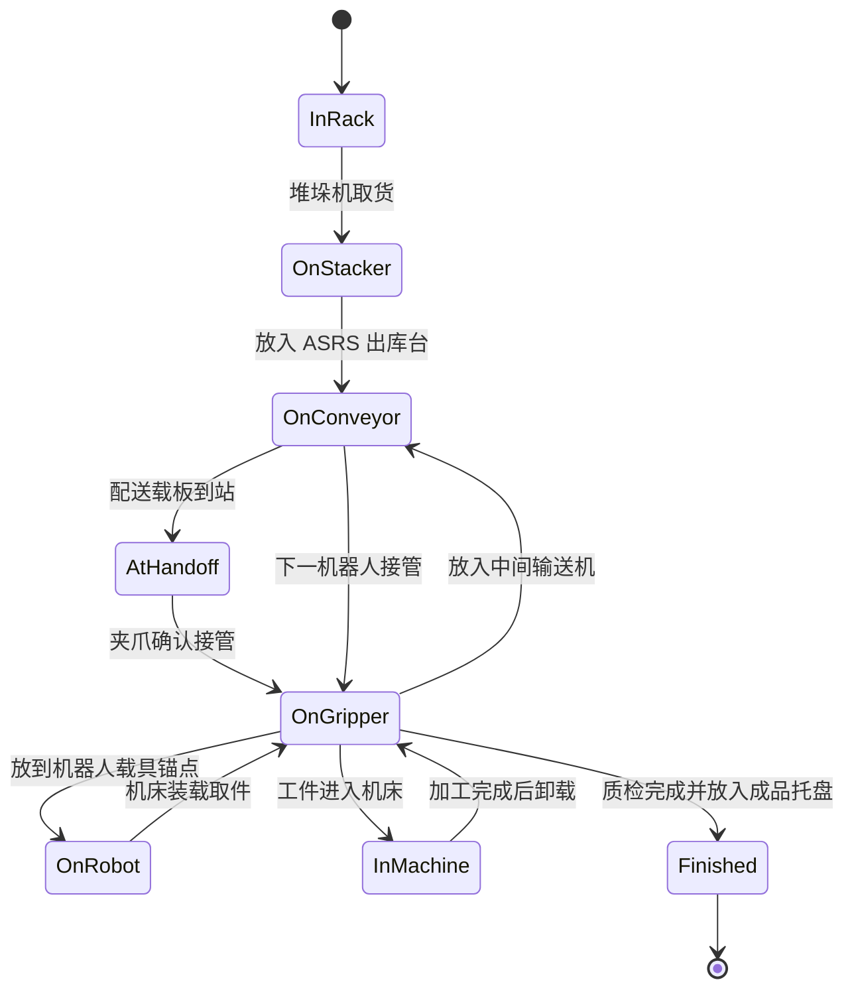

# 仿真车间整体运行框架

## 1. 控制思想

系统以“单一真实工件对象”为数据主线，用生命周期状态记录工件当前位置和所有者。仓库、货运载板、机器人、机床、输送机和成品区之间不创建替身工件，只在物理交接确认后转移同一对象的归属。

## 2. 整体思想流程线

```mermaid
flowchart LR
    A[离线演示启动] --> B[FactoryTwinController<br/>设备注册 / HUD / 事件流]
    B --> C[FactoryProductionFlowAnimator<br/>三条产线统一编排]
    C --> D[向共享 ASRS 请求工件]
    D --> E[WarehouseFlowAnimator<br/>堆垛机取货]
    E --> F[ASRS 出库输送台]
    F --> G[中央配送载板]
    G --> H[载板到达产线并等待]
    H --> I[RobotMotionController<br/>轨道移动]
    I --> J[RobotArmAnimator<br/>夹爪接触与抓取]
    J --> K{GRASP CONFIRMED}
    K -->|Yes| L[工件归属转移到夹爪]
    K -->|No| H
    L --> M[空配送载板返回 ASRS]
    L --> N[MachineFlowController<br/>机床装载 / 加工 / 卸载]
    N --> O[ConveyorFlowController<br/>中间输送交接]
    O --> P{是否最后工位}
    P -->|No| I
    P -->|Yes| Q[质检 QC PASS]
    Q --> R[对应产线成品托盘]
    R --> S[统计 completedJobs]
    S --> C

    T[ResourcePool / ResourceLock] -. 互斥与 FIFO 排队 .-> C
    U[FactoryFlowIntegrityMonitor] -. 每 0.5 秒校验 .-> C
    U -. 校验工件归属 / 锚点 / 越界 / 轨道占用 .-> R
```

## 3. 工件生命周期



## 4. 核心源码职责

| 模块 | 主要职责 |
| --- | --- |
| `FactoryTwinController.cs` | 运行模式、设备注册、HUD 数据、离线演示和未来通信入口 |
| `FactoryProductionFlowAnimator.cs` | 三条产线状态机、工件生命周期、设备交接与成品计数 |
| `WarehouseFlowAnimator.cs` | 共享 ASRS、堆垛机、出库台、中央配送载板及返回逻辑 |
| `RobotMotionController.cs` | 轨道机器人移动、交互、等待和电量状态 |
| `RobotArmAnimator.cs` | 机械臂姿态、夹爪、`Grip Anchor` 和载具货物锚点 |
| `AgvView.cs` | 轨道平移及固定朝向，防止机器人摇摆 |
| `MachineFlowController.cs` | 机床等待、装载、加工和卸载状态 |
| `ConveyorFlowController.cs` | 输送机交接状态 |
| `ResourcePool.cs` | 共享资源互斥锁与 FIFO 排队 |
| `FactoryFlowIntegrityMonitor.cs` | 工件 ID、归属、父节点、边界和轨道占用校验 |
| `FactoryCameraController.cs` | 全局、产线和 ASRS 观察视角 |
| `FactoryHudView.cs` | KPI、设备状态和事件流展示 |

## 5. 控制层与模型层边界

```text
生产编排层（不随 Blender 模型替换）
  ├─ FactoryProductionFlowAnimator
  ├─ WarehouseFlowAnimator
  ├─ ResourcePool / ResourceLock
  └─ FactoryFlowIntegrityMonitor

设备控制层（保留公共接口和锚点）
  ├─ RobotMotionController / RobotArmAnimator / AgvView
  ├─ MachineFlowController / MachineDoorAnimator
  └─ ConveyorFlowController / ConveyorAnimator

可视模型层（Blender 主要替换区域）
  ├─ 机械臂网格、机床外壳、输送机网格
  ├─ ASRS 货架、堆垛机、载板网格
  └─ 车间环境、材质、灯光和装饰
```

