# Blender 模型接入边界

## 接入原则

1. 将 Blender 模型作为现有设备根节点的“可视子节点”接入。
2. 保留挂载控制脚本的根节点、设备 Key 和状态机组件。
3. 保留并重新校准 `Grip Anchor`、`Payload Carrier Anchor`、机床装载点、输送交接点和成品槽位。
4. 动画和网格的局部坐标归零，尺寸使用统一的米制单位，应用 Blender 中的 Scale/Rotation 后再导出。
5. 碰撞体与高精度网格分离，使用简化 Collider，避免因模型复杂度影响仿真性能。
6. 每替换一类设备就先完成单机交接测试，不一次性替换整个车间。

## 不可破坏的控制契约

- 工件必须是同一对象连续流转，不能用隐藏、销毁或复制来伪造交接。
- 夹爪真正到位前，不允许把工件状态切换为 `OnGripper`。
- 收到 `GRASP CONFIRMED` 之前，中央配送载板不得返回。
- 不改变轨道机器人固定朝向和线性移动的约束。
- 成品不得落在机器人轨道或中央物流轨道上。
- `FactoryFlowIntegrityMonitor` 必须保持启用。

## 建议接入顺序

```mermaid
flowchart LR
    A[备份基线] --> B[导入车间静态环境]
    B --> C[替换机床可视模型]
    C --> D[替换输送机可视模型]
    D --> E[替换轨道载具与机械臂]
    E --> F[重新标定夹爪与货物锚点]
    F --> G[替换 ASRS / 堆垛机 / 载板]
    G --> H[单工位抓放测试]
    H --> I[单产线完整流转]
    I --> J[三线并行 240 秒烟雾测试]
    J --> K[30 分钟耐久验证]
```

## 每阶段验收点

- Unity 冷编译无 `error CS`。
- 夹爪、工件、机床和载板没有明显穿模。
- 工件归属和父节点与生命周期状态一致。
- 三条产线均能完成 `QC PASS → FINISHED GOODS`。
- 无 `Factory Flow Integrity` 违规和运行时异常。

